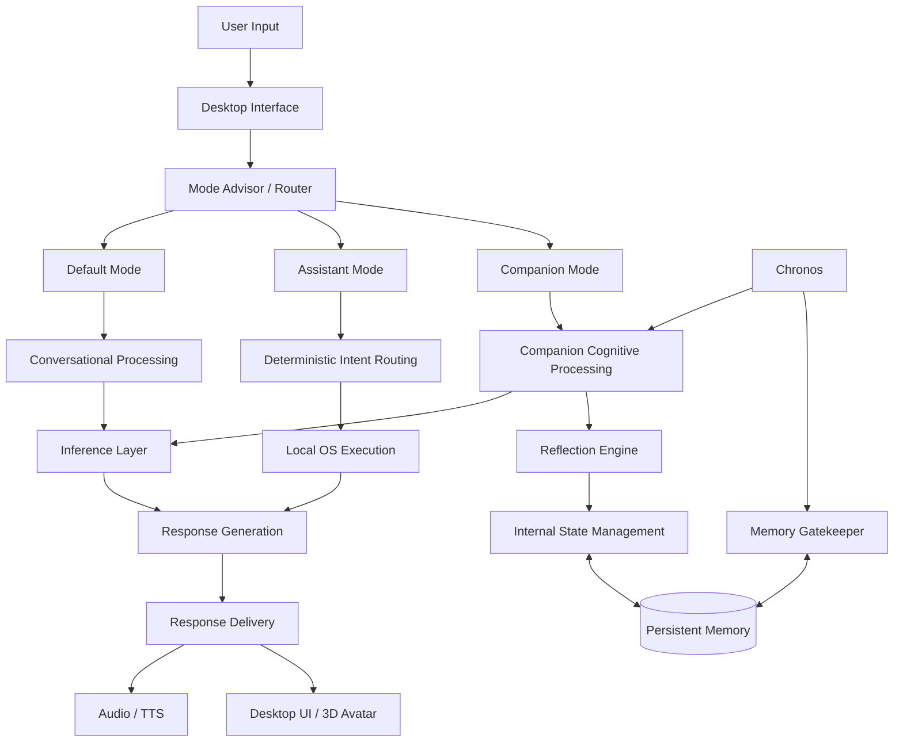

# Persistent AI Companion Architecture

**An experimental modular AI system exploring persistent memory, contextual reasoning, functional emotional dynamics, and autonomous cognitive processes.**

A Python-based desktop AI system designed to explore the development of persistent, context-aware digital companions. The architecture combines multi-layer memory management, multi-mode interaction, asynchronous cognitive processing, temporal contextualization, and native operating system integration.

Rather than treating an AI companion as a stateless conversational interface, this project explores how persistent memory, internal state management, and reflective processes can contribute to behavioral continuity across interactions and sessions.

The system is developed under constrained hardware conditions, with a focus on lightweight engineering, modularity, deterministic execution, and selective use of cloud-based inference.

---

## 1. Project Overview

The system is built around three complementary operational modes, a shared persistent memory architecture, and specialized cognitive and execution components.

Its main architectural pillars include:

- **Multi-Mode Architecture:** Three distinct operational postures — `Default`, `Assistant`, and `Companion` — sharing a unified identity and persistent memory while maintaining functional and behavioral separation.
- **Hybrid Memory Architecture:** A multi-layer persistence and retrieval system combining conversational context, rolling summaries, structured user facts, and episodic narrative memory.
- **Cognitive Processing:** A dual-loop architecture combining synchronous pre-response processing with asynchronous background reflection.
- **Functional Affective Dynamics:** An experimental internal state-management system designed to influence conversational behavior, contextual interpretation, and interaction initiative.
- **Temporal Contextualization:** A dedicated temporal processing component (`Chronos`) that tracks elapsed time, session continuity, and contextual time gaps.
- **Deterministic Tool Orchestration:** Separation between language-model interpretation and local system execution, with Python retaining control over operational actions.
- **Multimodal Desktop Integration:** Native desktop interaction, speech processing, audio synthesis, and a synchronized 3D avatar interface.

## 2. System Architecture

The architecture separates conversational processing, deterministic execution, memory management, and asynchronous cognitive operations.

### High-Level Architecture

*Conceptual representation of the main system components and their relationships.*

### Architectural Principles

**Separation of Responsibilities**

Language models handle natural-language interpretation, contextual synthesis, and conversational generation. Deterministic Python components retain responsibility for routing, memory retrieval policies, system execution, and internal state constraints.

**Shared Identity, Isolated Operational Modes**

The three modes operate over shared persistent context without requiring identical conversational behavior. Mode-specific processing and contextual filtering help prevent unwanted behavioral and stylistic contamination.

**Synchronous and Asynchronous Processing**

User-facing interactions and background cognitive operations follow separate execution paths. This allows reflection and memory maintenance to evolve without unnecessarily blocking the conversational interface.

**Lightweight Execution**

The system favors lightweight custom components and native operating system capabilities over unnecessary orchestration frameworks.

## 3. Multi-Mode Operational Architecture

The system operates through three distinct functional postures, each designed for a different interaction objective.

| Mode | Primary Purpose | Operational Characteristics |
|---|---|---|
| `Default` | General interaction | Lightweight conversational behavior and contextual assistance |
| `Assistant` | Task-oriented assistance | Analytical processing, problem-solving, and deterministic tool orchestration |
| `Companion` | Persistent relational interaction | Reflective processing, affective dynamics, and evolving conversational perspective |

All three modes share the same persistent identity and memory infrastructure while maintaining separate behavioral configurations and contextual processing rules.

A deterministic Python-based Mode Advisor supports mode selection and routing. Contextual filtering further reduces cross-mode stylistic contamination without fragmenting the underlying conversational history.

The objective is to maintain continuity of information while allowing each operational posture to retain its own functional purpose.

## 4. Cognitive Architecture

The Companion mode is the primary experimental focus of the cognitive architecture.

Its design explores how internal processing, reflection, temporal awareness, and functional affective dynamics can interact to influence conversational behavior.

### 4.1 Dual-Loop Cognitive Processing

The architecture separates cognitive operations into two complementary loops.

**Fast Loop — Synchronous Processing**

A pre-response processing stage evaluates conversational context and produces structured internal assessments before the final user-facing response.

This processing is designed to contribute contextual interpretation and conversational coherence without exposing internal processing traces as ordinary spoken output.

**Slow Loop — Asynchronous Reflection Engine**

A background process periodically analyzes recent conversational interactions and previous reflective states.

Its responsibilities include:

- Evaluating conversational developments over time.
- Reassessing contextual and relational information.
- Maintaining continuity across interaction sessions.
- Identifying unresolved conversational threads.
- Proposing updates to the system's internal affective and volitional state.

The asynchronous architecture separates reflective operations from real-time response generation.

### 4.2 Functional Affective Dynamics — Psyche

`Psyche` is an experimental internal state-management component designed to represent evolving affective and volitional conditions.

Rather than relying exclusively on static personality prompts or superficial sentiment labels, the system explores bounded internal state transitions informed by contextual interpretation and background reflection.

These internal dynamics are intended to influence aspects of interaction such as:

- Trust and relational continuity.
- Openness and conversational engagement.
- Interest and curiosity.
- Autonomy and initiative.
- Resistance and behavioral stability.

The objective is to investigate how functional internal states can contribute to persistent behavioral characteristics rather than merely changing the emotional tone of generated text.

These mechanisms represent computational behavioral models, not evidence of subjective emotions or consciousness.

### 4.3 Temporal Contextualization — Chronos

`Chronos` is a dedicated temporal processing component responsible for maintaining awareness of the system's interaction timeline.

It extends basic timestamp handling by considering:

- System uptime and elapsed interaction time.
- Temporal context within active sessions.
- Time gaps between conversational sessions.
- Interaction timing and processing latency.

Chronos contributes temporal information to contextual processing and memory management, helping the system distinguish between continuous interactions, resumed conversations, and longer periods of absence.

## 5. Hybrid Memory Architecture

Persistent memory is one of the central engineering components of the system.

The architecture moves beyond conventional vector-only retrieval by combining structured persistence, narrative summarization, semantic retrieval, and deterministic context selection.

It consists of four primary memory layers coordinated by a fifth retrieval and orchestration component.

| Component | Responsibility |
|---|---|
| **Layer 1 — Short-Term Memory** | Active conversational context and recent interaction history. |
| **Layer 2 — Session Summary** | Rolling summaries preserving relevant conversational developments across sessions. |
| **Layer 3 — User Facts** | Structured, persistent information about the user, including stable preferences and relevant personal context. |
| **Layer 4 — Episodic Memory** | Condensed narrative representations of past interactions, retrieved through semantic and lexical relevance. |
| **Layer 5 — Memory Gatekeeper** | Deterministic orchestration of memory selection and retrieval according to contextual and temporal relevance. |

### Memory Retrieval Strategy

The Memory Gatekeeper coordinates the retrieval process, determining which memory components should contribute to the current context.

The architecture combines:

- Time-bounded conversational context.
- Background summary generation.
- Structured fact extraction and validation.
- Episodic narrative retrieval.
- Hybrid semantic and lexical relevance scoring.
- Context-sensitive retrieval policies to limit unnecessary prompt expansion.

Cloud-based embeddings are used to avoid the computational and memory overhead associated with local embedding inference on constrained hardware. An offline lexical retrieval fallback provides an alternative retrieval path.

The overall objective is to balance long-term contextual continuity, retrieval relevance, and inference efficiency while controlling context-window consumption.

## 6. Engineering Challenges & Architectural Trade-offs

Developing a persistent AI system under legacy hardware constraints requires balancing inference capabilities, computational overhead, memory consistency, and operational reliability.

The following challenges have influenced the architecture and its design decisions.

### 6.1 Behavioral Isolation vs. Shared Memory

**Challenge:** Maintaining a consistent information history across different operational modes without allowing their distinct conversational styles to contaminate one another.

**Architectural Approach:** Shared persistent storage combined with mode-specific contextual filtering and behavioral isolation. This allows information continuity without requiring identical conversational context across all modes.

### 6.2 Memory Fragmentation vs. Narrative Continuity

**Challenge:** Conventional semantic retrieval can return isolated conversational fragments without preserving the narrative context in which they occurred. Local embedding inference can also introduce unnecessary resource consumption on older hardware.

**Architectural Approach:** A hybrid memory architecture combining structured facts, rolling summaries, episodic representations, cloud embeddings, and lexical retrieval. A deterministic Memory Gatekeeper controls the selection of relevant information before prompt construction.

### 6.3 Deterministic Execution vs. LLM Tool Reliability

**Challenge:** Delegating system-level commands entirely to an LLM introduces unnecessary latency and potential formatting or execution errors.

**Architectural Approach:** Python-first intent routing separates operational command detection and execution from natural-language generation. The operating system handles deterministic actions, while the LLM is used where conversational interpretation or synthesis adds value.

### 6.4 Static Personality vs. Evolving Internal Perspective

**Challenge:** Static persona prompts and simplistic sentiment-based state systems offer limited mechanisms for maintaining evolving conversational characteristics over time.

**Architectural Approach:** A dual-loop cognitive architecture combines synchronous pre-response processing with asynchronous reflection. A bounded internal state-management component uses reflective outputs to influence subsequent interaction behavior and conversational initiative.

### 6.5 Hardware Constraints vs. Interaction Responsiveness

**Challenge:** Running multiple processes, desktop interfaces, audio synthesis, and local processing on legacy hardware can create resource contention, interface freezes, and unnecessary latency.

**Architectural Approach:** Lightweight native UI components, asynchronous background workers, audio pre-fetching, external inference services, and process separation reduce local computational overhead.

### 6.6 Provider Dependency vs. Inference Resilience

**Challenge:** Dependence on a single inference provider introduces an operational vulnerability when services become unavailable or return malformed responses.

**Architectural Approach:** A multi-provider inference architecture combines a primary conversational model with a tiered fallback strategy for conversational continuity and background analytical tasks.

## 7. Technology Stack

The system combines lightweight local components with external inference and language-processing services.

| Layer | Technologies |
|---|---|
| Backend & Core Logic | Python 3, event-driven and multithreaded processing |
| Persistence | SQLite |
| Memory Retrieval | Cloud Embeddings, hybrid semantic and lexical retrieval |
| Primary Inference | Google Gemini API (native REST / SSE streaming) |
| Secondary Inference | Groq API (fallback and background analytical processing) |
| Speech Synthesis | Edge-TTS |
| Speech Recognition | Groq Whisper |
| Audio Playback | Native macOS `afplay` and `say` |
| Desktop Interface | Python Tkinter |
| 3D Avatar | Unity Engine, VRM runtime |
| Inter-Process Communication | UDP sockets |
| Operating System Integration | AppleScript, `osascript`, Bash and native BSD utilities |

### Development Environment

The project is developed and tested on a legacy desktop environment:

- **Hardware:** 2017 Intel dual-core architecture.
- **Operating System:** macOS High Sierra 10.13.6.
- **Primary Language:** Python 3.

Hardware constraints are treated as architectural design considerations rather than simply limitations to work around.

The system prioritizes lightweight execution, selective delegation, asynchronous processing, and minimal dependency overhead.

## 8. Development Progress & Roadmap

The project has evolved from desktop integration and persistent conversational memory toward more advanced cognitive and behavioral architectures.

### Foundation — Core Architecture

**Established foundations**

- Desktop interface and native macOS integration.
- Persistent SQLite storage.
- Multi-layer memory infrastructure.
- Shared identity and multi-mode operation.
- Deterministic system command routing.
- External inference integration.
- Audio and 3D avatar synchronization.

### Cognitive Architecture — Current Development Focus

**Ongoing development and refinement**

- Dual-loop cognitive processing.
- Background Reflection Engine.
- Temporal contextualization through Chronos.
- Functional affective and volitional state management.
- Episodic memory refinement and contextual retrieval.
- Improved continuity across sessions and operational modes.

### Future Directions — Extended Autonomy

**Longer-term development objectives**

- Expanded proactive conversational initiative.
- More sophisticated curiosity-driven interaction.
- Unified runtime configuration and diagnostics interface.
- Expanded analytical capabilities in Assistant mode.
- Further refinement of associative and episodic memory retrieval.
- More advanced interaction between internal state, reflection, and autonomous processes.

The roadmap reflects the project's experimental direction and does not imply that all proposed capabilities are currently implemented.

## 9. Repository Scope

This repository serves as a technical and architectural portfolio documenting the design principles, engineering decisions, and evolution of the project.

The complete source code is currently not public. The system is closely coupled to its development environment and includes ongoing private experiments and implementation-specific components.

The repository therefore focuses on:

- System architecture and component relationships.
- Engineering challenges and design trade-offs.
- Technology choices and development decisions.
- Conceptual descriptions of internal mechanisms.
- Evolution of the project's architecture and roadmap.

The objective is to demonstrate the architectural reasoning and engineering process behind the system without exposing its complete internal implementation.

## 10. Development Philosophy

The project follows a pragmatic, problem-driven engineering approach.

Rather than adopting large, abstract orchestration frameworks by default, it favors lightweight custom components where they provide greater control, transparency, and efficiency.

Its core design principles are:

- **Determinism where reliability matters:** Operational execution, routing, and state constraints remain under explicit programmatic control.
- **Modularity and separation of concerns:** Specialized components handle memory, inference, reflection, temporal context, and system integration.
- **Selective use of LLM capabilities:** Language models are used for interpretation, contextual synthesis, and reflective processing rather than replacing deterministic application logic.
- **Efficiency under constraints:** Hardware and resource limitations influence architectural decisions from the beginning.
- **Incremental experimentation:** New cognitive and behavioral mechanisms are introduced, evaluated, and refined as the system evolves.

Ultimately, this project explores how persistent memory, contextual processing, and functional internal dynamics can be combined into a modular AI architecture that goes beyond conventional stateless conversational systems.

---

*Exploring the architecture of persistent, context-aware AI companions.*
